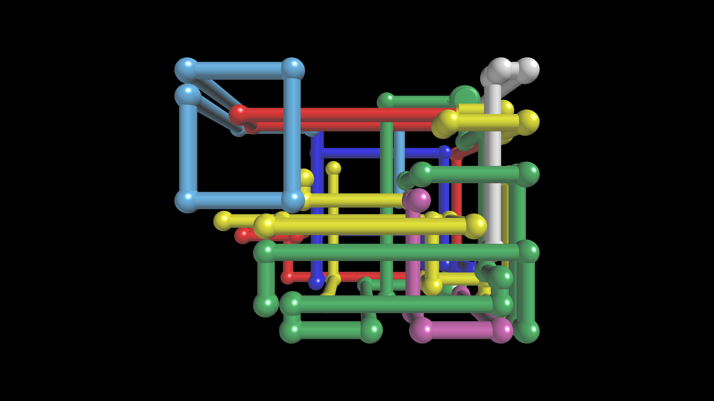

# wlpipes

The Windows 95 *3D Pipes* screensaver, rebuilt as a native Wayland client.

Coloured pipes grow through a three dimensional box, turning at right angles
and sprouting ball joints, until the box fills and the scene starts over. It
covers every monitor as a `wlr-layer-shell` overlay, above panels and bars, and
gets out of the way the moment you touch anything.

Written in Zig. No X11, no toolkit, no compositor plugin — just a Wayland
client and about 500KB of GLES.



## Why another one

The pipe growth follows xscreensaver's `hacks/glx/pipes.c` closely enough to
look right, including the detail most remakes miss: a run ends when its head
has **no free neighbour**, not when it hits a wall. Long before reaching a wall
the pipe has usually boxed itself in against pipe it already laid, and that is
what packs the box. Check only for walls and it walks through itself and never
fills.

The lighting is a port of the original's fixed-function setup, down to only
light 0 carrying a specular term — which is why there is one clean highlight
per pipe rather than two competing ones.

And yes, there is a teapot.

## Install

Requires a compositor with `wlr-layer-shell` — Hyprland, Sway, river, Wayfire.

```sh
git clone https://github.com/flacyak/pipes.git
cd pipes/packaging
makepkg -si
```

The `PKGBUILD` pins itself to the `v0.1.0` tag rather than to your checkout, so
it builds the released source no matter which branch you happen to be on.

That installs:

| Path | |
|---|---|
| `/usr/bin/wlpipes` | the screensaver |
| `/usr/share/man/man1/wlpipes.1` | `man wlpipes` |
| `/usr/share/doc/wlpipes/hypridle.conf.example` | ready-made idle configuration |

## Hyprland

Add a listener to `~/.config/hypr/hypridle.conf`:

```
listener {
    timeout = 300
    on-timeout = wlpipes
    on-resume = pkill -x wlpipes
}
```

Then `systemctl --user restart hypridle`. The full example, including blanking
the screen later and chaining into `hyprlock`, is installed at
`/usr/share/doc/wlpipes/hypridle.conf.example`.

`on-resume` is belt and braces: the screensaver already exits on any key,
click, pointer motion or touch.

The overlay registers on the overlay layer under the namespace `wlpipes`, which
is what `hyprctl layers` reports and what compositor rules match on:

```
layerrule = noanim, wlpipes
```

## Usage

```sh
wlpipes                   # fullscreen overlay on every monitor
wlpipes --windowed        # ordinary window, for development
wlpipes --help
```

Exit codes: `0` normal, `1` runtime failure, `2` bad usage.

## Build

Requires Zig 0.16. CI builds, tests and runs `makepkg` on every push and pull
request, so the package is verified there rather than by hand.

```sh
zig build          # -> zig-out/bin/wlpipes
zig build test
zig build run -- --help
```

### A warning

The overlay takes an **exclusive keyboard grab**. If its input handling breaks,
your session becomes untypeable. When changing anything under `src/wl/`, test
with `--windowed` first, where the compositor keeps the keyboard, and run the
overlay with `--max-seconds N` until you trust it.

## Credit

The pipe-growth algorithm follows xscreensaver's `hacks/glx/pipes.c` by Marcelo
Vianna (1997), including its turn-probability curve and colour palette.
